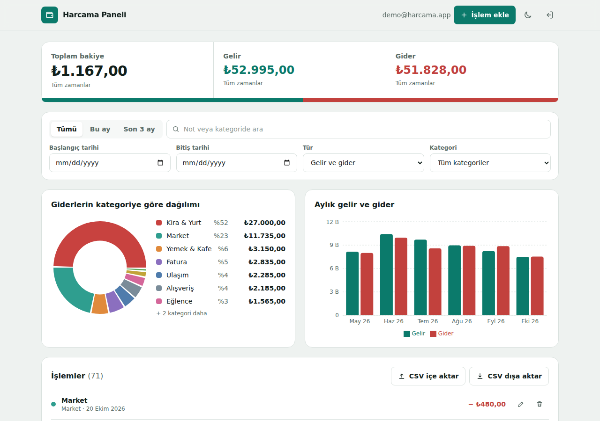
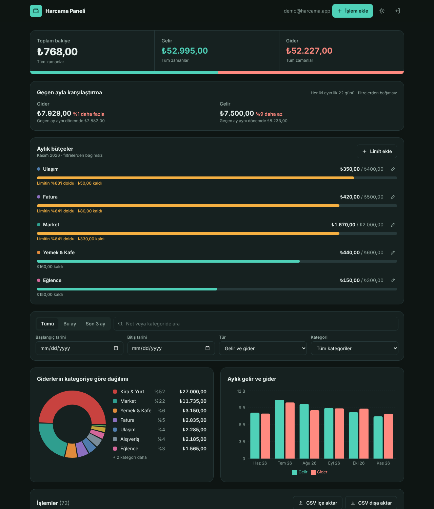
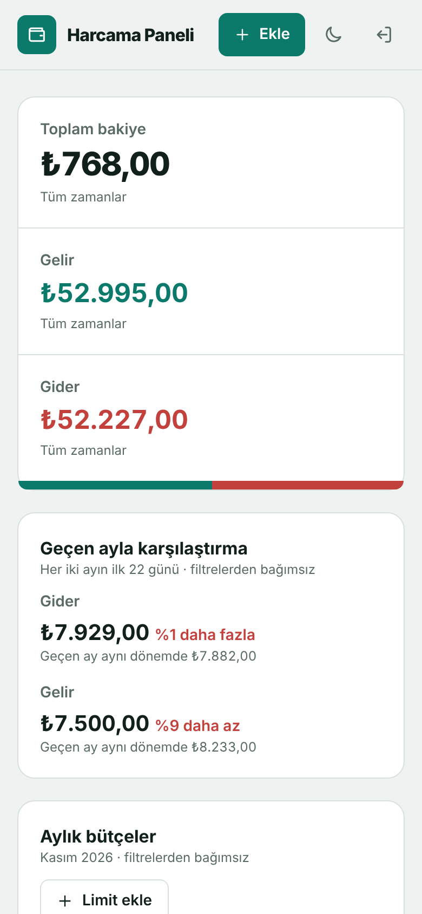
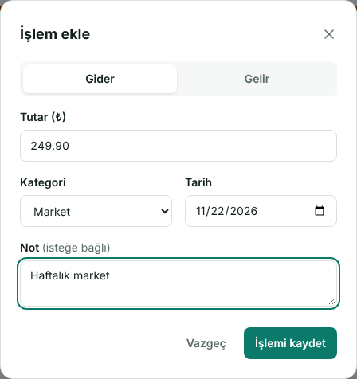

# Harcama Paneli

A personal budget and expense tracking dashboard. Record income and expenses, see where your money goes by category, follow the monthly trend, and move your data in and out with CSV. The interface is in Turkish and amounts are in Turkish lira (₺).

**Live demo:** https://harcama-paneli-cg6f.vercel.app



<details>
<summary>More screenshots</summary>

| Dark mode | Mobile | Add transaction |
| --- | --- | --- |
|  |  |  |

</details>

## Features

- Email/password sign-up and sign-in (Firebase Authentication), plus password reset
- Add, edit and delete transactions: income or expense, category, date, amount, note
- Dashboard: total balance, income/expense for the selected period, expense breakdown by category (donut chart) and a monthly income vs. expense bar chart
- Filter by date range, category and type, quick presets (all, this month, last 3 months), and full-text search over notes and categories
- CSV export (of the currently filtered list) and CSV import with a validation preview
- Dark mode (follows the system setting, remembers your choice), responsive layout, empty states
- Data is private per user and enforced on the server with Firestore security rules

## Tech stack

React 19, TypeScript, Vite, Tailwind CSS v4, Firebase (Authentication and Firestore), Recharts, Vitest. Deployed on Vercel.

## Getting started

Requirements: Node.js 20 or newer.

```bash
git clone https://github.com/mertokzlky/harcama-paneli.git
cd harcama-paneli
npm install
cp .env.example .env   # then fill in your Firebase values (see below)
npm run dev
```

On Windows PowerShell use `Copy-Item .env.example .env`.

### Firebase setup

> **You must use your own Firebase project.** This repository does not contain any API keys. Put your own values in a local `.env` file, which is git-ignored.

1. Create a project in the [Firebase console](https://console.firebase.google.com/).
2. **Authentication → Sign-in method:** enable **Email/Password**.
3. **Firestore Database:** create a database (production mode).
4. **Firestore → Rules:** paste the contents of [`firestore.rules`](firestore.rules) and publish. Without these rules, the app cannot read or write data.
5. **Project settings → General → Your apps:** add a **Web app** and copy its config into `.env`:

   ```env
   VITE_FIREBASE_API_KEY=...
   VITE_FIREBASE_AUTH_DOMAIN=...
   VITE_FIREBASE_PROJECT_ID=...
   VITE_FIREBASE_STORAGE_BUCKET=...
   VITE_FIREBASE_MESSAGING_SENDER_ID=...
   VITE_FIREBASE_APP_ID=...
   ```

6. Restart `npm run dev` after changing `.env`.

If the keys are missing, the app shows a setup screen instead of crashing.

### Demo mode (no Firebase)

To try the UI without a Firebase project, run it with local sample data stored in your browser's `localStorage`:

```bash
# macOS / Linux
VITE_DEMO_MODE=true npm run dev

# Windows PowerShell
$env:VITE_DEMO_MODE="true"; npm run dev
```

Demo mode is for development and screenshots only. Do not enable it in production.

## Scripts

| Command | What it does |
| --- | --- |
| `npm run dev` | Start the dev server |
| `npm run build` | Type-check and build for production |
| `npm run preview` | Preview the production build |
| `npm run lint` | Lint with oxlint |
| `npm test` | Run unit tests (Vitest) |

## CSV format

Export produces a semicolon-separated, UTF-8 file that opens correctly in Turkish Excel:

```csv
Tarih;Tür;Kategori;Tutar;Not
2026-10-04;Gider;Market;650;Haftalık market
2026-10-01;Gelir;Burs & Harçlık;6000;Aylık burs
```

Import accepts `;`, `,` or tab delimiters, dates as `YYYY-MM-DD` or `DD.MM.YYYY`, amounts like `1.234,56` or `1234.56`, and `Gelir`/`Gider` (or `income`/`expense`) as the type. Unknown categories fall back to "Diğer". Invalid rows are listed and skipped. Importing the same file twice creates duplicates.

## Project structure

```
src/
  components/   auth/, dashboard/ (summary, charts), transactions/ (form, list, filters, CSV), ui/
  hooks/        auth, theme, toast, transactions subscription
  lib/          pure logic: money parsing/formatting, filters, stats, CSV (unit-tested)
  services/     Firebase implementation + demo implementation behind one interface
firestore.rules Firestore security rules
```

Design notes:

- **Money is stored as integer kuruş** (`amountMinor`), never floating point, so totals are exact.
- **Dates are stored as `YYYY-MM-DD` strings** to avoid time-zone shifts.
- **Data model:** `users/{uid}/transactions/{id}` with `type`, `amountMinor`, `category`, `date`, `note`, `createdAt`, `updatedAt`.
- All business logic lives in `src/lib` as pure functions with unit tests; Firebase is only touched in `src/services`.

## Security notes

- Firestore rules allow a user to access only `users/{their uid}/transactions`, and validate field types, amount range, date format and note length on every write.
- Firebase web config values are identifiers, not secrets; what actually protects your data is the security rules and Authentication. They are still kept out of git, as is good practice.
- CSV export neutralises cells starting with `=`, `+`, `-` or `@` to prevent spreadsheet formula injection.
- For production, consider enabling [Firebase App Check](https://firebase.google.com/docs/app-check) and restricting your API key by HTTP referrer in Google Cloud Console.

## Deploy to Vercel

1. Push the repository to GitHub and import it in Vercel (framework preset: **Vite**).
2. Add the six `VITE_FIREBASE_*` variables under **Settings → Environment Variables**.
3. In the Firebase console, go to **Authentication → Settings → Authorized domains** and add your Vercel domain (for example `harcama-paneli.vercel.app`). Without this, sign-in fails on the deployed site.
4. Deploy, then put the live URL at the top of this README.

## Known limitations

- All of a user's transactions are loaded and filtered on the client. This is fine for personal use (thousands of rows) but would need pagination or server-side queries at larger scale.
- Single currency (TRY) and a fixed category list.
- No duplicate detection on CSV import.

## Roadmap

- Custom categories and budgets per category
- Recurring transactions
- Firestore rules tests with the Firebase emulator
- End-to-end tests (Playwright)
